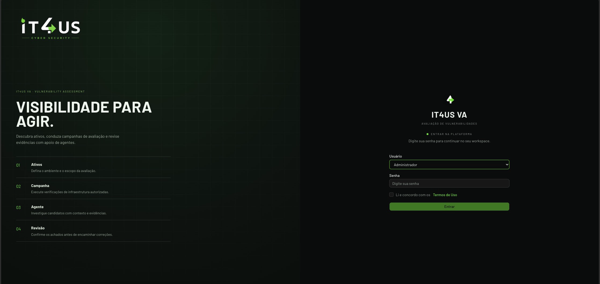
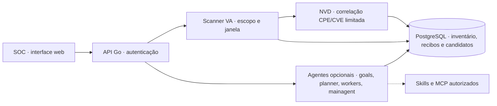

# IT4US VA

Console do SOC para descobrir serviços em IPs autorizados, registrar evidências e revisar candidatos a vulnerabilidade. O scanner de infraestrutura funciona sem IA. A IA e os conectores MCP são opcionais para investigação e integração.

> **Origem e licença:** este projeto é um fork de [ARTEX, de Autumn-27](https://github.com/Autumn-27/artex), adaptado pela IT4US para o fluxo de avaliação de infraestrutura do SOC. O código permanece sob [AGPL-3.0](LICENSE). As capturas e instruções abaixo retratam o IT4US VA.

## O que o SOC consegue fazer

- Criar uma tarefa para o cliente e uma campanha limitada a IPs ou CIDRs, portas TCP, responsável pela autorização e fim da janela.
- Revisar a lista expandida de IPs antes de iniciar o Nmap (`-sT -sV -Pn -n`), acompanhar o progresso e interromper a execução.
- Ver serviços no inventário e candidatos pendentes em **Achados**. Porta aberta ou banner não é vulnerabilidade confirmada; o analista decide após revisar a evidência.
- Após o discovery, consultar automaticamente a NVD para CPEs com versão identificada e registrar CVEs possivelmente aplicáveis como candidatos pendentes, com CPE, critério e fonte. Limites e falhas de cobertura ficam no recibo. Também é possível consultar uma CVE específica manualmente.
- Configurar Claude/OpenCode e MCP em **Conexões**, se a equipe quiser apoio do agente. Discovery de portas não depende dessas integrações.

O scanner não executa exploit, NSE, autenticação, brute force ou movimento lateral. A correlação automática não confirma que o alvo é vulnerável: patches, backports e condições adicionais exigem validação específica. Checks de impacto por CVE e scans autenticados ainda não fazem parte desta versão.

## Tela real

Entrada da instância de demonstração IT4US VA, sem dados de clientes. As telas internas exigem autenticação e não foram publicadas neste README.



## Instalação com Docker Compose

**Requisitos na máquina do SOC:** Docker com Compose, Go 1.26.3 ou superior, Node.js/npm e Git. O Go e o npm geram o binário Linux e a interface antes do build da imagem. O container da aplicação já inclui Nmap e PostgreSQL roda em outro container. O host precisa ter acesso de rede aos IPs autorizados; instalar na máquina local não dá alcance automático à rede do cliente.

```bash
git clone https://github.com/MTheux/it4us-va.git
cd it4us-va
cp .env.example .env
```

Edite `.env` e substitua `POSTGRES_PASSWORD=change-me-please` por uma senha forte e exclusiva. Deixe as chaves de IA vazias se quiser começar apenas com discovery. Não coloque senhas ou chaves no README, em tickets ou em comandos compartilhados.

```bash
./scripts/prepare-compose.sh
docker compose -f docker-compose.yml up -d --build
docker compose -f docker-compose.yml ps
curl -fsS http://localhost:8787/api/health
```

Use `-f docker-compose.yml` nos comandos: o repositório contém um `docker-compose.override.yml` usado em uma instalação local com outra porta; o arquivo principal publica a aplicação em **8787**. No primeiro acesso, abra `http://localhost:8787/setup` e defina a senha de administrador. Para a equipe acessar de outra máquina, publique o serviço por HTTPS na rede interna/VPN, mantendo PostgreSQL fora da exposição pública.

Para acompanhar problemas de inicialização:

```bash
docker compose -f docker-compose.yml logs -f it4us
```

Para parar sem apagar os dados:

```bash
docker compose -f docker-compose.yml down
```

O volume do PostgreSQL e os diretórios `data/` e `skills/` persistem entre recriações dos containers. Faça backup antes de atualizar ou mover a instalação.

### Atualização

```bash
git pull --ff-only
./scripts/prepare-compose.sh
docker compose -f docker-compose.yml up -d --build
curl -fsS http://localhost:8787/api/health
```

Esse fluxo recompila o código deste repositório. O `IT4US_TAG` da imagem local não substitui `git pull` e o script `update.sh` legado espera uma imagem remota que o Compose atual não define.

## Primeiro teste com um IP do cliente

1. Confirme a autorização escrita, o **IP literal** ou CIDR exato, a origem de rede permitida, as portas, a janela de execução e o contato do cliente. O IP de teste deve ser fornecido ao operador do SOC; não há alvo real embutido neste guia.
2. Crie uma tarefa para esse cliente em **Tarefas**.
3. Abra **Execuções VA** → **Analisar infraestrutura**. Selecione a tarefa, informe somente o IP autorizado e comece por **Portas comuns** ou pelas portas acordadas em **Personalizar**. Preencha **Autorizado por** e o fim da janela.
4. Clique **Revisar execução**, confira cada IP expandido e a quantidade de portas, confirme o escopo na tela e então inicie. **Interromper** cancela a campanha em andamento.
5. Quando o discovery terminar, o VA correlaciona automaticamente os CPEs precisos com a NVD. Abra a execução para ver a cobertura da consulta e **Achados** para revisar serviços e CVEs possivelmente aplicáveis. Se houver outra CVE de interesse, use **Verificar CVE específica** com a campanha concluída.

IPs/CIDRs são expandidos antes do início; nomes de host não são aceitos. A lista personalizada aceita até 1.000 portas e o perfil **Todas as portas** tem orçamento de IP × porta. Consulte os [limites do scanner e da correlação automática](VA-SCANNER-v1.2-2026-11-11.md) antes de ampliar uma campanha. O IP usado para o teste não deve aparecer em prints públicos nem em issues.

## IA, MCP e dados

Em **Conexões**, o SOC pode testar uma chave Claude ou uma instalação local OpenCode. O indicador **Conectado** só aparece após uma resposta do provedor. Um MCP só aparece conectado após `tools/list` responder; a equipe escolhe quais agentes podem usar cada conector. [Detalhes e limites das conexões](docs/conexoes-soc-v1.0-2026-11-11.md).

A demonstração inclui dois relatórios fictícios para testar leitura e download. Isso não significa que Jira/Rovo esteja conectado: o painel ainda não implementa OAuth do Rovo, e um token estático depende da configuração da organização Atlassian. Configure integrações reais com credenciais próprias do SOC.

A chave de IA e os cabeçalhos de autenticação MCP não são devolvidos pela interface após salvar, mas ficam armazenados no PostgreSQL. Proteja o banco, o volume, os backups e o acesso administrativo. Os recibos de campanhas ficam em `data/va-runs/`; trate esses arquivos como evidência do cliente.

## Arquitetura em uma visão



O núcleo de agentes herdado do projeto original permanece: `goals` organiza objetivos, `planner` cria tarefas de investigação, `workers` executam as ações permitidas e `mainagent` apoia o analista. O fluxo VA executa discovery e correlação de CVEs automaticamente, sem iniciar uma exploração pelo agente ou confirmar impacto. A aprovação e a revisão do SOC continuam necessárias.

## Licença e uso

O código é distribuído sob [AGPL-3.0](LICENSE); mantenha a atribuição e cumpra as obrigações da licença ao redistribuir ou disponibilizar uma versão modificada pela rede. Use a ferramenta somente em sistemas próprios ou com autorização explícita e dentro do escopo e da janela acordados. Minimize dados pessoais e preserve as evidências conforme o processo do cliente e do SOC.
